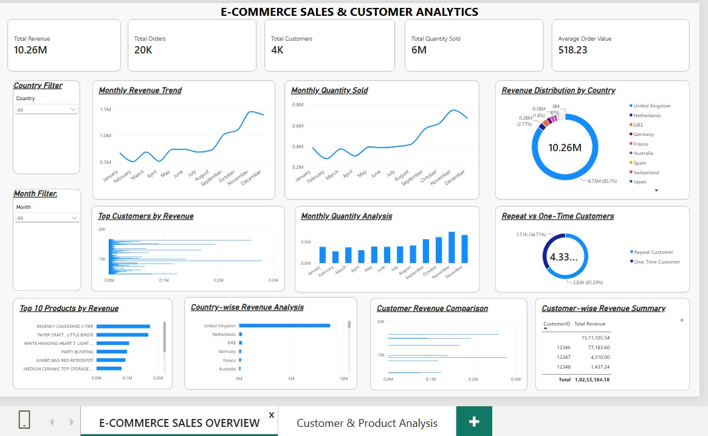
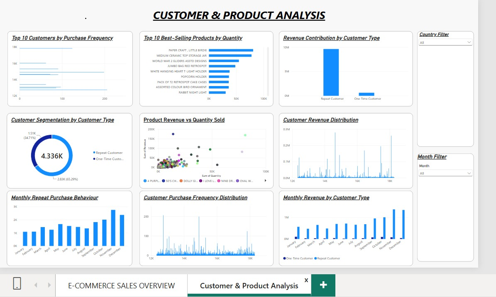

# E-Commerce Sales & Customer Analytics

## Project Overview
An end-to-end data analytics project focused on analyzing e-commerce transactions, sales performance, product demand, and customer purchasing behaviour using Python, SQL, Excel, and Power BI.

## Project Objectives
- Analyze overall sales performance and revenue trends.
- Identify top-performing products and countries.
- Understand customer purchasing patterns.
- Segment customers based on purchase behaviour.
- Build interactive dashboards to communicate business insights.

## Tools & Technologies
- **Programming:** Python
- **Libraries:** Pandas, NumPy, Matplotlib
- **Database:** MySQL
- **Visualization:** Excel, Power BI
- **Environment:** Jupyter Notebook, MySQL Workbench

## Dataset
The project uses the Online Retail transactional dataset containing invoice details, product descriptions, quantities, prices, customer IDs, and country information.

## Project Workflow

1. **Data Cleaning & Preprocessing:** Handled missing values, duplicates, and data inconsistencies.
2. **Exploratory Data Analysis:** Analyzed revenue, quantity, products, customers, and monthly trends using Python.
3. **SQL Analysis:** Used MySQL queries to calculate revenue, orders, average order value, product performance, and customer purchasing patterns.
4. **Customer Segmentation:** Applied RFM analysis to understand customer value and purchasing behaviour.
5. **Excel Dashboard:** Created PivotTables, PivotCharts, and KPI-based sales summaries.
6. **Power BI Dashboard:** Developed interactive reports with KPI cards, charts, and Country and Month filters.

## Power BI Dashboard

### Page 1 – E-Commerce Sales Overview

### Page 2 – Customer & Product Analysis

## Key Business Insights
- Evaluated monthly revenue and quantity trends.
- Identified top-selling products based on revenue and quantity.
- Compared revenue contribution across countries.
- Analyzed repeat and one-time customer purchasing behaviour.
- Examined customer purchase frequency and revenue distribution.

## Conclusion
This project demonstrates an end-to-end data analytics workflow, from raw data cleaning and exploratory analysis to SQL-based business analysis and interactive dashboard development. It helped develop practical skills in data processing, querying, visualization, and extracting meaningful business insights.

## Author
**Abinaya R.S.**  
GitHub: [abinayars](https://github.com/abinayars)
